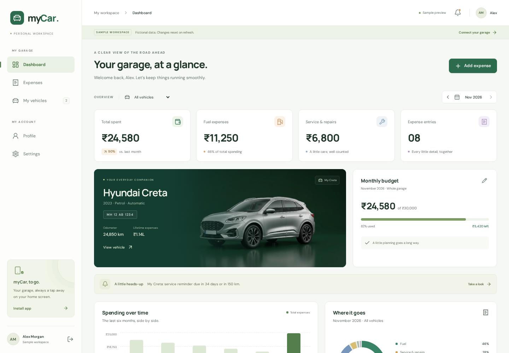

# myCar

**Your personal garage, in your pocket.** Track vehicles and expenses, see where your money goes, and keep important care dates in view.

<p align="center">
  <a href="https://github.com/rajeshlande/mycar/actions/workflows/pages.yml"></a>
  <a href="https://github.com/rajeshlande/mycar/commits/main"></a>
  <a href="https://github.com/rajeshlande/mycar/stargazers"></a>
</p>

<p align="center"><a href="https://rajeshlande.github.io/mycar/">Open myCar</a> · <a href="#getting-started">Get started</a> · <a href="#deployment">Deploy</a> · <a href="CHANGELOG.md">Changelog</a></p>

myCar is a mobile-first, installable web app built with React, Vite and Supabase. Explore the **sample workspace** without an account, or connect your own Supabase project to save your garage across devices.



## Features

- **Your garage:** manage multiple cars, motorcycles, scooters and mopeds; set a default vehicle and view its expense history. Make and model suggestions support Indian vehicles, while custom entries cover anything not listed. Fuel choices include alternative, dual-fuel and custom values.
- **Expense tracking:** record car washes and other costs; add, edit and delete expenses; filter, search, sort and export results as CSV. Optional payment methods are labels only—myCar does not process payments or collect card details.
- **Dashboard:** review monthly spending, fuel and service costs, trends, categories, budget progress and recent activity. Customize which sections are visible; signed-in preferences follow your account across devices.
- **Care reminders:** see upcoming and overdue service and insurance dates in the app.
- **Your account:** sign up, confirm your email, sign in, reset your password, and update your profile and preferences.
- **Made for mobile:** light, dark and system themes, responsive layouts and a PWA install experience where supported.

> **Sample mode is temporary.** Its fictional data and dashboard preferences are kept in memory and reset on refresh. Real accounts and cloud storage require Supabase configuration.

## Getting started

### Requirements

- Node.js **22.12 or later** (Node 26 LTS recommended; CI uses Node 26)
- npm
- A Supabase project with email authentication enabled for real accounts
- HTTPS for deployed PWA features; localhost works for development

### 1. Install and start

From the project directory in Git Bash (also works in macOS/Linux shells):

```bash
npm ci
cp .env.example .env.local
npm run dev
```

Open the URL printed in the terminal. The server prefers port `5173` and automatically chooses another if it is occupied. Without Supabase credentials, select **Explore a sample workspace**. To use real accounts, complete the next steps and restart the development server.

### 2. Set up Supabase

1. Create or choose a dedicated Supabase project.
2. In **SQL Editor**, run the entire canonical [`supabase/schema.sql`](supabase/schema.sql). It creates the profiles, vehicles and expenses tables, owner-scoped RLS policies, grants, constraints, triggers and helper function.
3. In **Project Settings → API**, copy your project URL and publishable key or legacy anon key. Add them to `.env.local`:

```dotenv
VITE_SUPABASE_URL=https://your-project.supabase.co
VITE_SUPABASE_ANON_KEY=your-publishable-or-anon-key
```

These are browser-visible values. **Never use a service-role key, secret key, database password or SMTP credential in a `VITE_` variable.** Public keys depend on correctly configured RLS and grants.

**Existing projects:** Back up first and test the current schema on staging, especially if you have customized tables or constraints. The canonical script includes the upgrades for vehicle types and fuels, expense payment methods and account dashboard preferences, and the car-wash expense category. It is designed to be rerunnable for the standard schema, but `CREATE TABLE IF NOT EXISTS` does not merge arbitrary existing schemas. Deployment does not run SQL for you.

### 3. Configure authentication redirects

In Supabase **Authentication → URL Configuration**, set the Site URL to your deployed app URL and allow the exact login and password-reset redirect URLs. For the myCar GitHub Pages site, add:

```text
https://rajeshlande.github.io/mycar/#/login
https://rajeshlande.github.io/mycar/#/reset-password
http://localhost:5173/#/login
http://localhost:5173/#/reset-password
```

If Vite uses another local port, allow the corresponding URLs as well. Keep email confirmation enabled. The client uses PKCE: use Supabase's default `{{ .ConfirmationURL }}` behavior or ensure custom templates honor the requested redirect, and open recovery links in the same browser that requested them. Configure custom SMTP and review authentication rate limits before public launch.

### 4. Verify your project

- [ ] Sign up, confirm the email, sign in and reset a password.
- [ ] Add a vehicle and create, edit and delete an expense; export a CSV.
- [ ] Save profile, settings and dashboard preferences; check them on another device.
- [ ] Confirm a second account cannot access the first account's data.
- [ ] Test sign-out, offline app-shell behavior and installation on real devices.

Live Supabase authentication, email delivery, physical-device behavior and screen-reader use must be verified in your own environment. See [`docs/VERIFICATION.md`](docs/VERIFICATION.md).

## Deployment

### GitHub Pages

1. In the repository's **Settings → Pages**, set the source to **GitHub Actions**.
2. Under **Settings → Secrets and variables → Actions**, add `VITE_SUPABASE_URL` and `VITE_SUPABASE_ANON_KEY` as repository secrets, using only public configuration.
3. Push to `main` or manually run **Deploy myCar to GitHub Pages** from Actions.
4. Set the Supabase Site URL and redirects for the final Pages URL as described above.

The workflow checks the project, builds and tests it, then deploys `dist`. Without the secrets it deploys in setup/sample mode. Relative assets and hash routing support repository paths. To check the Pages build locally:

```bash
npm run build:pages
npm run check:pages
npm run preview -- --base=/mycar/ --port 4175
```

Open `http://localhost:4175/mycar/`. Other static hosts can use `npm run build`, publish `dist`, supply the same public variables at build time and serve over HTTPS. Keep the service worker and precache manifest at the app root and do not CDN-cache Supabase API or Auth responses.

## Development and testing

| Command | Purpose |
| --- | --- |
| `npm run dev` | Start the development server |
| `npm run build` | Build for production |
| `npm run build:pages` | Build for GitHub Pages |
| `npm run preview` | Serve the production build |
| `npm test` | Run logic and SQL/RLS tests using PGlite |
| `npm run test:browser` | Run Playwright UI and mocked Supabase contract tests |
| `npm run security:check` | Check browser-source credentials and worker guards |
| `npm run check:agents` | Check agent instructions and local skills |
| `npm run check:pages` | Validate built Pages/PWA output |
| `npm run version:check` | Check version alignment |

For browser tests, build first and install Chromium:

```bash
npm run build
npx playwright install chromium
npm run test:browser
```

Linux/CI may require `npx playwright install --with-deps chromium`. The suite uses local servers and intercepted Supabase responses; it does not prove a hosted project or mailbox works. See [`docs/VERIFICATION.md`](docs/VERIFICATION.md) for test details and outstanding checks.

If port 5173 is occupied, use the fallback URL or choose a port with `npm run dev -- --port 5174`. Close an old development server only if you recognize it; do not terminate an unknown process. Vite 8 may also prevent a second development server for the same project from sharing its cache; use the existing server or stop the recognized old server before starting another.

## Data, privacy and limitations

- Amounts are stored in integer **paise** and displayed in INR; there is no currency conversion. Odometers are stored in kilometres, with optional mile display/input.
- Records are scoped to the authenticated user. Deleting a vehicle also deletes its expenses; the app asks for confirmation.
- The service worker caches the static app shell, not Supabase API/Auth responses or private financial records. There is no offline data cache or write queue; reconnect to load or save data.
- Reminders are in-app only—not push notifications or emails. There are no receipt uploads, OCR, account deletion or in-app email-address changes.
- Vehicle suggestions are not an exhaustive or continuously updated catalogue; images are generic illustrations.
- The owner is responsible for a production privacy policy, retention rules, support contact and SMTP configuration.

## Project guide

```text
src/components/    Shared interface components
src/pages/         Authentication, dashboard, vehicles, expenses and settings
src/lib/           Data, authentication, calculations and PWA utilities
public/            PWA assets and static service worker
supabase/          Canonical schema and database policies
tests/             Logic, database and browser tests
docs/              Verification, versioning and deployment notes
```

[`AGENTS.md`](AGENTS.md) contains the project instructions for coding agents; [`CLAUDE.md`](CLAUDE.md) and [repo-local skills](.claude/README.md) provide additional guidance. For releases, see [`docs/VERSIONING.md`](docs/VERSIONING.md) and [`docs/GITHUB_PUSH.md`](docs/GITHUB_PUSH.md).

myCar adapts the technical foundation of [yoga_studio](https://github.com/rajeshlande/yoga_studio). The interface and vehicle and expense workflows are specific to myCar. See [third-party notices](THIRD_PARTY_NOTICES.md).

## License

MIT — see [LICENSE](LICENSE).
